

  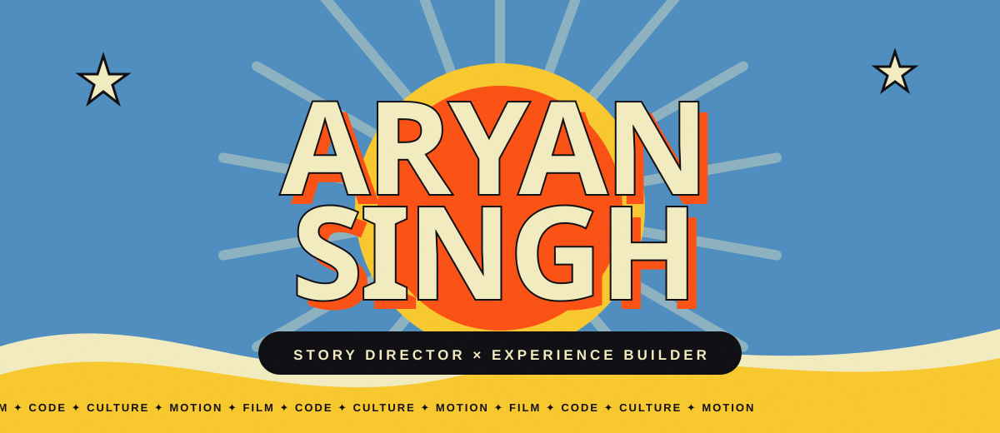
    
  
  
  

 

  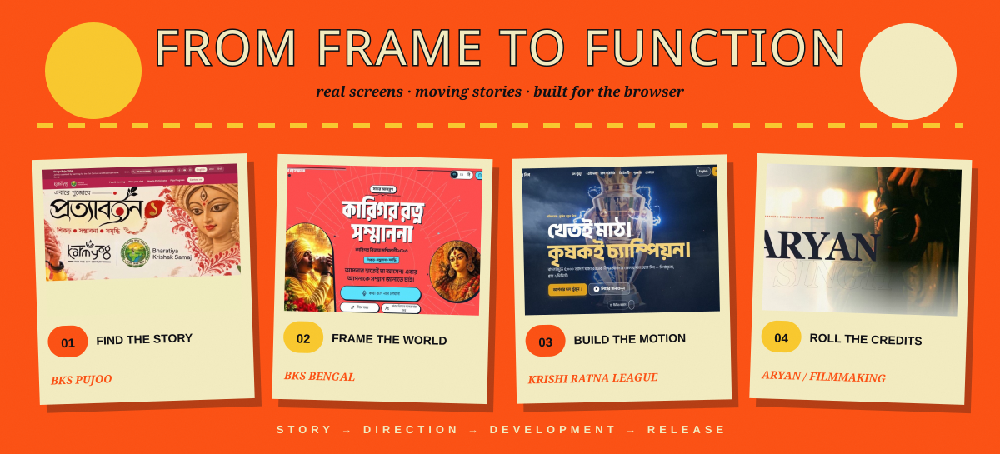

 

<h2 align="center">SELECTED WORK · THE REEL</h2>

<i>Click a poster and step inside the build.</i>

  <a href="https://bks-pujoo.vercel.app/site/?lang=en">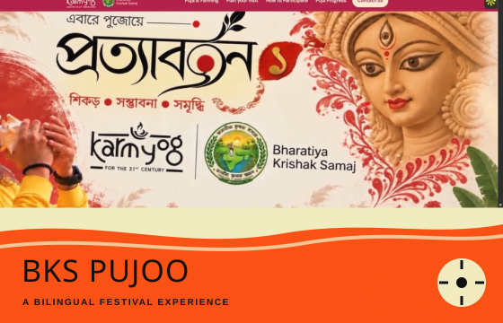</a>
  <a href="https://bks-bengal.vercel.app">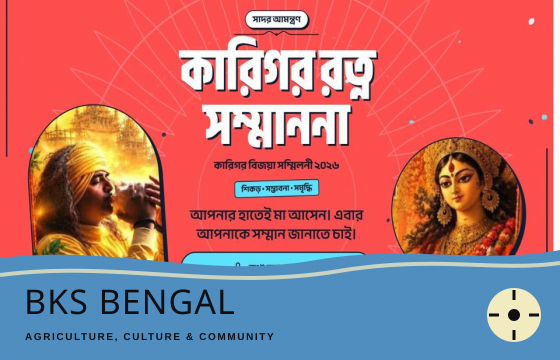</a>

  <a href="https://krl-site.vercel.app">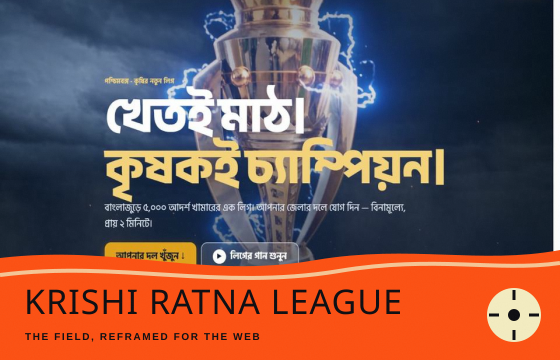</a>
  <a href="https://pravasi-krishi-bandhu-cinematic-tau.vercel.app">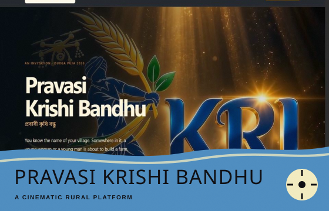</a>

  <a href="https://bks-pujo-demo.vercel.app">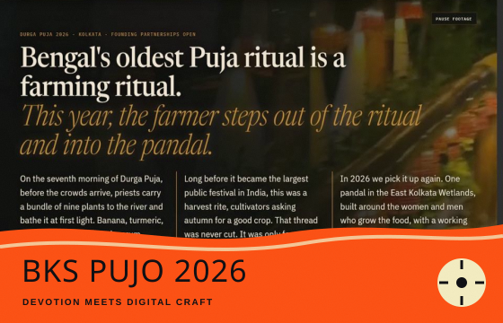</a>
  <a href="https://aryan-film-making.vercel.app">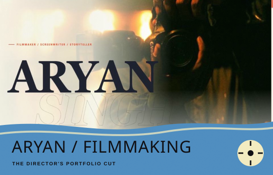</a>

 

  

 

  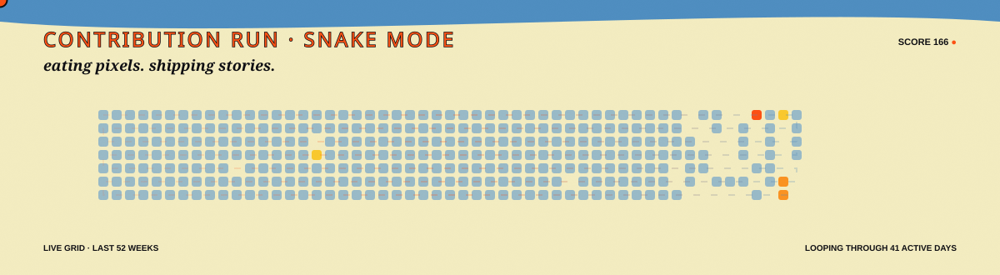

 

  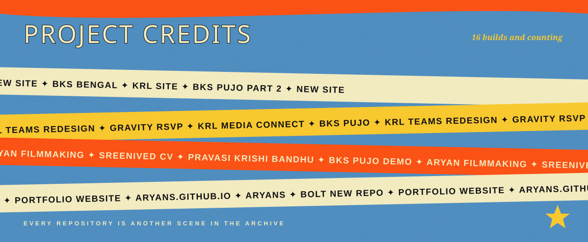

  
<b>OPEN THE COMPLETE SOURCE INDEX</b>

   

| Project | Portal |
| :--- | :---: |
| **BKS Pujoo** | [Live](https://bks-pujoo.vercel.app/site/?lang=en) · [Code](https://github.com/aryansingh173173-lab/bks-pujo) |
| **bks-bengal** | [Live](https://bks-bengal.vercel.app) · [Code](https://github.com/aryansingh173173-lab/bks-bengal) |
| **krl-site** | [Live](https://krl-site.vercel.app) · [Code](https://github.com/aryansingh173173-lab/krl-site) |
| **bks-pujo-part-2** | [Code](https://github.com/aryansingh173173-lab/bks-pujo-part-2) |
| **new-site** | [Code](https://github.com/aryansingh173173-lab/new-site) |
| **krl-teams-redesign** | [Code](https://github.com/aryansingh173173-lab/krl-teams-redesign) |
| **gravity-rsvp** | [Live](https://gravity-rsvp.vercel.app) · [Code](https://github.com/aryansingh173173-lab/gravity-rsvp) |
| **krl-media-connect-redesign** | [Code](https://github.com/aryansingh173173-lab/krl-media-connect-redesign) |
| **pravasi-krishi-bandhu-cinematic** | [Live](https://pravasi-krishi-bandhu-cinematic-tau.vercel.app) · [Code](https://github.com/aryansingh173173-lab/pravasi-krishi-bandhu-cinematic) |
| **bks-pujo-demo** | [Live](https://bks-pujo-demo.vercel.app) · [Code](https://github.com/aryansingh173173-lab/bks-pujo-demo) |
| **Aryan-Film-making** | [Live](https://aryan-film-making.vercel.app) · [Code](https://github.com/aryansingh173173-lab/Aryan-Film-making) |
| **Sreenived-cv** | [Code](https://github.com/aryansingh173173-lab/Sreenived-cv) |
| **bolt-new-repo** | [Code](https://github.com/aryansingh173173-lab/bolt-new-repo) |
| **portfolio-website** | [Code](https://github.com/aryansingh173173-lab/portfolio-website) |
| **aryans.github.io** | [Code](https://github.com/aryansingh173173-lab/aryans.github.io) |
| **aryans** | [Code](https://github.com/aryansingh173173-lab/aryans) |

 

  
    
  

