<div align="center">
  

  <br />

  <a href="https://aryan-film-making.vercel.app"></a>
  <a href="https://github.com/aryansingh173173-lab?tab=repositories"></a>
  
</div>

<br />

I turn stories into digital worlds. My work lives where **cinema, culture, live events, and interactive design** meet—built with strong visual direction, motion, and a little theatrical drama.

```text
CURRENT QUEST   Crafting cinematic web experiences for communities and live events
SPECIAL MOVES   Story direction · Motion-first UI · Visual systems · Rapid prototyping
PLAYER CLASS    Filmmaker × Creative Developer
```

## ⚡ Player loadout

<div align="center">
  
</div>

<br />

| Creative direction | Development | Experience design |
| :--- | :--- | :--- |
| 🎬 Filmmaking & screenwriting | ⚡ JavaScript & TypeScript | 🎮 Motion-first interfaces |
| 📷 Cinematography | 🧩 React & modern web tools | 🗣️ Voice-led journeys |
| ✍️ Narrative systems | 🚀 Vercel deployment | 🌏 Bilingual storytelling |

## 🎮 Featured missions

<table>
  <tr>
    <td width="50%" valign="top">
      <h3>🌺 BKS Bengal</h3>
      <p>An animated, voice-first invitation and registration experience for Durga Puja kaarigars.</p>
      <p><code>JavaScript</code> <code>CSS</code> <code>Voice UX</code></p>
      <a href="https://bks-bengal.vercel.app"><b>▶ Launch experience</b></a> · <a href="https://github.com/aryansingh173173-lab/bks-bengal">Source</a>
    </td>
    <td width="50%" valign="top">
      <h3>🏆 KRL Site</h3>
      <p>The digital home of Krishi Ratna League—built as a bold, modern world for its community.</p>
      <p><code>Web Experience</code> <code>Visual Design</code> <code>Vercel</code></p>
      <a href="https://krl-site.vercel.app"><b>▶ Visit live</b></a> · <a href="https://github.com/aryansingh173173-lab/krl-site">Source</a>
    </td>
  </tr>
  <tr>
    <td width="50%" valign="top">
      <h3>🪐 Gravity RSVP</h3>
      <p>An immersive RSVP flow that treats an event invitation like entering another universe.</p>
      <p><code>JavaScript</code> <code>HTML</code> <code>Docker</code></p>
      <a href="https://gravity-rsvp.vercel.app"><b>▶ Enter orbit</b></a> · <a href="https://github.com/aryansingh173173-lab/gravity-rsvp">Source</a>
    </td>
    <td width="50%" valign="top">
      <h3>🌾 Pravasi Krishi Bandhu</h3>
      <p>A warm, cinematic video-led story for the Krishi Ratna League Bengal community.</p>
      <p><code>HTML</code> <code>CSS</code> <code>JavaScript</code></p>
      <a href="https://pravasi-krishi-bandhu-cinematic-tau.vercel.app"><b>▶ Watch the story</b></a> · <a href="https://github.com/aryansingh173173-lab/pravasi-krishi-bandhu-cinematic">Source</a>
    </td>
  </tr>
  <tr>
    <td width="50%" valign="top">
      <h3>📰 KRL Media Connect</h3>
      <p>An interactive bilingual event journal designed to make a gathering feel alive online.</p>
      <p><code>JavaScript</code> <code>CSS</code> <code>Bilingual UX</code></p>
      <a href="https://github.com/aryansingh173173-lab/krl-media-connect-redesign"><b>▶ Explore build</b></a>
    </td>
    <td width="50%" valign="top">
      <h3>🎥 Aryan Film-making</h3>
      <p>A filmmaker portfolio for screenwriting, cinematography, production, and visual storytelling.</p>
      <p><code>TypeScript</code> <code>CSS</code> <code>Portfolio</code></p>
      <a href="https://aryan-film-making.vercel.app"><b>▶ View portfolio</b></a> · <a href="https://github.com/aryansingh173173-lab/Aryan-Film-making">Source</a>
    </td>
  </tr>
</table>

## 🕹️ Activity arcade

<div align="center">
  
</div>

## 🗺️ Project vault

Every public build has a place on the map.

| Project | World | Stack | Portal |
| :--- | :--- | :--- | :---: |
| **bks-bengal** | Voice-first Kaarigar Sammelan invitation | JavaScript | [Live](https://bks-bengal.vercel.app) · [Code](https://github.com/aryansingh173173-lab/bks-bengal) |
| **krl-site** | Krishi Ratna League digital home | Web | [Live](https://krl-site.vercel.app) · [Code](https://github.com/aryansingh173173-lab/krl-site) |
| **bks-pujo-part-2** | BKS Pujo, chapter two | JavaScript | [Code](https://github.com/aryansingh173173-lab/bks-pujo-part-2) |
| **new-site** | Visual web experiment | CSS | [Code](https://github.com/aryansingh173173-lab/new-site) |
| **bks-pujo** | Full Pujo experience | JavaScript | [Code](https://github.com/aryansingh173173-lab/bks-pujo) |
| **krl-teams-redesign** | Gold-and-burgundy team showcase | JavaScript | [Code](https://github.com/aryansingh173173-lab/krl-teams-redesign) |
| **gravity-rsvp** | Cinematic RSVP journey | JavaScript | [Live](https://gravity-rsvp.vercel.app) · [Code](https://github.com/aryansingh173173-lab/gravity-rsvp) |
| **krl-media-connect-redesign** | Interactive bilingual event journal | JavaScript | [Code](https://github.com/aryansingh173173-lab/krl-media-connect-redesign) |
| **pravasi-krishi-bandhu-cinematic** | Video-led community story | HTML | [Live](https://pravasi-krishi-bandhu-cinematic-tau.vercel.app) · [Code](https://github.com/aryansingh173173-lab/pravasi-krishi-bandhu-cinematic) |
| **bks-pujo-demo** | Pujo experience prototype | HTML | [Live](https://bks-pujo-demo.vercel.app) · [Code](https://github.com/aryansingh173173-lab/bks-pujo-demo) |
| **Aryan-Film-making** | Filmmaking portfolio | TypeScript | [Live](https://aryan-film-making.vercel.app) · [Code](https://github.com/aryansingh173173-lab/Aryan-Film-making) |
| **Sreenived-cv** | Typeset CV system | TeX | [Code](https://github.com/aryansingh173173-lab/Sreenived-cv) |
| **bolt-new-repo** | Build sandbox | — | [Code](https://github.com/aryansingh173173-lab/bolt-new-repo) |
| **portfolio-website** | Early portfolio build | HTML | [Code](https://github.com/aryansingh173173-lab/portfolio-website) |
| **aryans.github.io** | Filmmaker profile experiment | Web | [Code](https://github.com/aryansingh173173-lab/aryans.github.io) |
| **aryans** | Storytelling profile concept | Web | [Code](https://github.com/aryansingh173173-lab/aryans) |

## 🎬 End credits

> Gold medalist at Inter-IIT (Kites) and GC (PANDEMONIUM). Always exploring new ways to make a screen feel like a story.

<div align="center">
  <a href="https://github.com/aryansingh173173-lab"></a>
  <br /><br />
  
</div>
